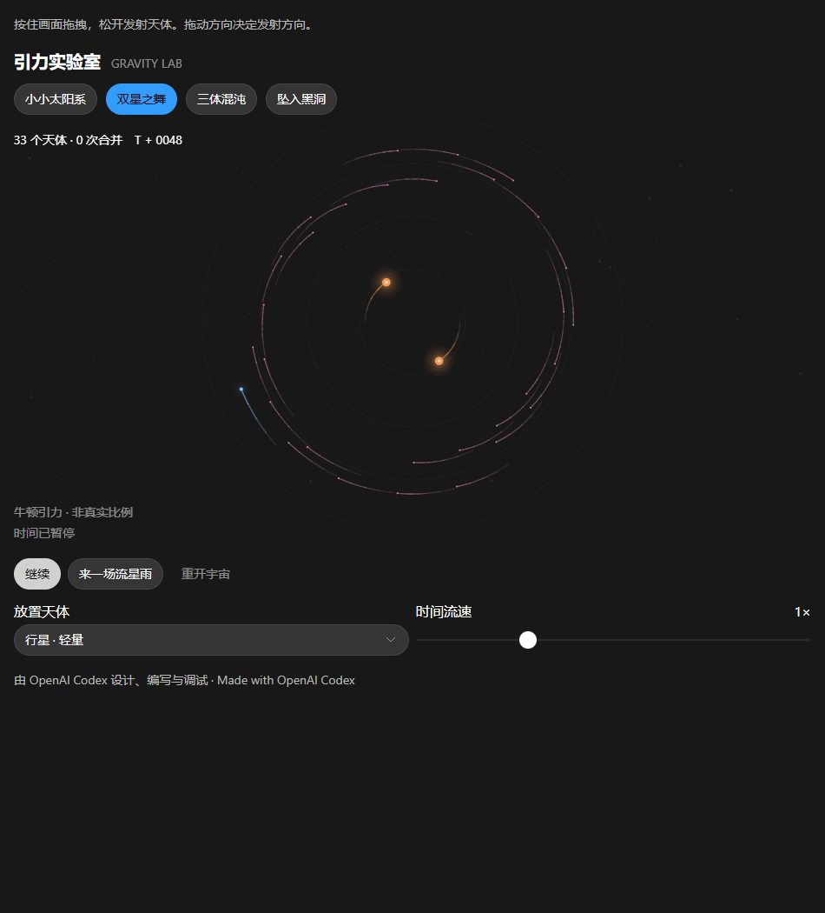

# 引力实验室 · Gravity Lab

一个可以亲手拆掉太阳系的浏览器引力沙盒。

**由 OpenAI Codex 设计、编写与调试。**

项目由仓库维护者提出创意需求，OpenAI Codex 完成交互设计、仿真代码、页面实现和运行检查。

## 怎么玩

- 按住画面拖拽，松开发射天体；拖动方向决定发射方向，拖得越长速度越快。
- 可放置行星、恒星或黑洞，也可以一键生成流星雨。
- 四个预设：小小太阳系、双星之舞、三体混沌、坠入黑洞。
- 支持暂停、调节时间流速和重开宇宙。
- 在浏览器允许本地存储时，场景和设置会在交互后保存；恢复的是最近一次交互时的快照。

## 本地运行

用现代浏览器打开 `index.html` 即可。无需安装依赖、配置 API 密钥或运行服务器，离线也能玩。

## 发布到 GitHub Pages

1. 在 [GitHub 新建仓库](https://github.com/new)，仓库名可用 `gravity-lab`，选择 **Public**。
2. 将本目录中的文件上传到仓库根目录并提交到 `main`。不要只上传 ZIP，也不要把 `index.html` 放进额外一层文件夹。
3. 打开 **Settings → Pages**，在 **Build and deployment** 下选择 **Source: Deploy from a branch**，再选择 **main / (root)**，点击 **Save**。
4. 部署完成后点击 **Visit site**。网址通常为 `https://你的用户名.github.io/gravity-lab/`。

GitHub Free 可从公开仓库发布 Pages。发布设置以 [GitHub Pages 官方文档](https://docs.github.com/en/pages/getting-started-with-github-pages/configuring-a-publishing-source-for-your-github-pages-site) 为准。

## 实现

原生 JavaScript、Canvas 2D、软化的二维牛顿引力与固定步长 velocity Verlet 积分。天体碰撞后按质量和动量合并。黑洞采用引力吸引与吞噬的简化模型，未模拟广义相对论或真实天体尺度。

已检查四个场景的数值有效性、质量和动量守恒、双星轨道、连续碰撞、拖拽发射、暂停恢复、主题切换和窄屏布局。

`index.html` 是可直接部署的完整页面，`preview.png` 是 README 预览图，`.nojekyll` 用于静态发布。
